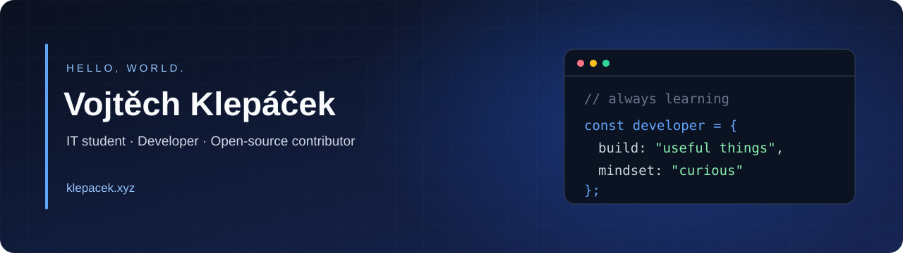

<a href="https://klepacek.xyz"></a>

<h1 align="center">Hey, I'm Vojtěch 👋</h1>
<p align="center"><b>IT Student · Developer · Open-Source Contributor</b><br />Building useful software. Exploring APIs. Learning how systems work.</p>

<p align="center">
  <a href="https://klepacek.xyz"></a>
  <a href="https://www.linkedin.com/in/vojt%C4%9Bch-klep%C3%A1%C4%8Dek-495a78430/"></a>
  <a href="https://dev.to/klepacek"></a>
  <a href="mailto:vojtechklep@gmail.com"></a>
</p>

<p align="center"><i>“Make it work. Make it clear. Make it better.”</i></p>

<h3 align="center">🛠️ Languages and Tools</h3>
<p align="center">
  <a href="https://skillicons.dev"></a><br />
  <a href="https://skillicons.dev"></a>
</p>
<p align="center"><sub>Also working with Adobe tools.</sub></p>

<h3 align="center">🐍 My Contributions</h3>
<p align="center">
  <picture>
    <source media="(prefers-color-scheme: dark)" srcset="https://raw.githubusercontent.com/klepacek/klepacek/output/github-snake-dark.svg" />
    <source media="(prefers-color-scheme: light)" srcset="https://raw.githubusercontent.com/klepacek/klepacek/output/github-snake.svg" />
    
  </picture>
</p>

## 🧑‍💻 About Me

I'm an Information Technology student at **SOŠ strojní a elektrotechnická Velešín** in the Czech Republic. I enjoy building useful software, working with APIs, and learning how systems work behind the scenes.

- 🔭 Contributing to **[OpenBakalari](https://github.com/klepacek/OpenBakalari)** and exploring open-source development
- ⚙️ Interested in **backend development, REST APIs, automation, and IT infrastructure**
- 🌱 Currently studying **Cisco IT Essentials, ECDL, and Google AI Fundamentals**
- 💬 Happy to talk about **JavaScript, Node.js, Python, and open source**
- ⚡ Fun fact: I was born on April Fools' Day!

## 🚀 Featured Project

### [OpenBakalari](https://github.com/klepacek/OpenBakalari)

An open-source project focused on the Bakaláři school information system. I've contributed improvements to **API error handling, automated endpoint tests, and continuous integration**.

---

### 📕 Latest Blog Posts

<!-- BLOG-POST-LIST:START -->
- 📕 [Your API Works. But Is It Actually Reliable?](https://dev.to/klepacek/your-api-works-but-is-it-actually-reliable-kgj)

<!-- BLOG-POST-LIST:END -->

### ⏱️ Weekly Coding Activity

<!--START_SECTION:waka-->

```txt
No activity tracked
```

<!--END_SECTION:waka-->

### 📈 GitHub Activity


### 🎓 Education & Learning

**SOŠ strojní a elektrotechnická Velešín** — Information Technology (2026–present)

- Cisco IT Essentials — in progress
- ECDL — in progress
- Google AI Fundamentals — in progress

**Languages**

| Language | Level | Evidence |
| :--- | :--- | :--- |
| 🇨🇿 Czech | Native | — |
| 🇬🇧 English | C2 | [EF SET Certificate](https://cert.efset.org/en/UJ1CC4) |
| 🇩🇪 German | A2–B1 | [ESL Certificate](https://imgur.com/a/0NVCn33) |


---

<p align="center"><b>Thanks for visiting!</b><br />Explore more of my work at <a href="https://klepacek.xyz">klepacek.xyz</a>.</p>
